# Struktur Database — Ruang Obat

> Dibuat dari skema MySQL aktual (database `obat`) pada 11/11/2026. Perbarui dokumen ini setiap ada migration baru.

## Ringkasan

Aplikasi manajemen stok obat Dinas Kesehatan: distribusi obat dari Gudang Dinas ke Puskesmas, lalu dari Puskesmas ke Pustu. Total **55 tabel**.

Prinsip utama:

- **Stok per batch** — `batch_stok` adalah sumber kebenaran jumlah stok; `stok_gudang` dan `stok_faskes` hanyalah agregat yang dipelihara oleh `App\Services\StokService`.
- **Batch di gudang vs faskes** — `batch_stok.fasilitas_id = NULL` berarti gudang dinas, terisi berarti faskes.
- **Semua pergerakan lewat satu service** — `StokService` menulis `riwayat_stok` setiap kali stok berubah.
- **Dokumen = header + detail** — permintaan, distribusi, penerimaan, LPLPO, RKO, opname, retur, dan neraca memakai pola header/detail.
- **Soft scope per faskes** — hampir semua data operasional memakai `fasilitas_id`; `NULL` pada tabel tertentu berarti level Dinas.

## Peta Tabel

| Grup | Tabel | Jumlah |
| --- | --- | ---: |
| Master Data | `fasilitas_kesehatan`, `obat`, `sumber_dana`, `suppliers` | 4 |
| Stok & Persediaan | `stok_gudang`, `stok_faskes`, `batch_stok`, `riwayat_stok`, `opname_stok`, `detail_opname_stok` | 6 |
| Permintaan & Distribusi | `permintaan_obat`, `detail_permintaan_obat`, `distribusi_obat`, `detail_distribusi_obat`, `penerimaan_stok`, `detail_penerimaan_stok` | 6 |
| Retur Obat | `retur_obat`, `detail_retur_obat`, `inspeksi_retur` | 3 |
| Pemakaian Obat | `pemakaian_obat`, `detail_pemakaian_obat` | 2 |
| Pelaporan & Perencanaan | `laporan_lplpo`, `detail_lplpo`, `laporan_rko`, `detail_rko`, `neraca_tahunan`, `detail_neraca_tahunan`, `detail_neraca_sumber_dana` | 7 |
| Anggaran & Cut-Off | `sumber_dana_penggunaan`, `tutup_buku` | 2 |
| Prediksi AI | `model_prediksi`, `prediksi_kebutuhan` | 2 |
| Pengaturan & Preferensi | `pengaturan_laporan`, `user_preferences`, `avatar_presets`, `settings` | 4 |
| User & Autentikasi | `users`, `socialite_users`, `password_reset_tokens`, `sessions` | 4 |
| Role & Permission | `roles`, `permissions`, `model_has_roles`, `model_has_permissions`, `role_has_permissions` | 5 |
| Aktivitas, Import & Infrastruktur | `activity_log`, `notifications`, `imports`, `exports`, `migrations`, `jobs`, `job_batches`, `failed_jobs`, `cache`, `cache_locks` | 10 |

## Diagram Relasi Inti

```mermaid
erDiagram
    fasilitas_kesehatan ||--o{ users : "punya user"
    fasilitas_kesehatan ||--o{ fasilitas_kesehatan : "puskesmas_induk"
    fasilitas_kesehatan ||--o{ stok_faskes : "stok"
    fasilitas_kesehatan ||--o{ batch_stok : "batch faskes"
    fasilitas_kesehatan ||--o{ permintaan_obat : "pengirim/tujuan"
    fasilitas_kesehatan ||--o{ distribusi_obat : "pengirim/penerima"
    fasilitas_kesehatan ||--o{ penerimaan_stok : "penerima"
    fasilitas_kesehatan ||--o{ retur_obat : "pengirim/penerima"
    fasilitas_kesehatan ||--o{ pemakaian_obat : "pemakaian"
    fasilitas_kesehatan ||--o{ laporan_lplpo : "laporan"
    fasilitas_kesehatan ||--o{ laporan_rko : "rencana"
    fasilitas_kesehatan ||--o{ neraca_tahunan : "neraca"
    fasilitas_kesehatan ||--o{ tutup_buku : "cut-off"
    fasilitas_kesehatan ||--o{ model_prediksi : "model"
    obat ||--o{ stok_gudang : "stok"
    obat ||--o{ stok_faskes : "stok"
    obat ||--o{ batch_stok : "batch"
    obat ||--o{ detail_penerimaan_stok : "item"
    obat ||--o{ detail_permintaan_obat : "item"
    obat ||--o{ detail_distribusi_obat : "item"
    obat ||--o{ detail_pemakaian_obat : "item"
    obat ||--o{ detail_lplpo : "item"
    obat ||--o{ detail_rko : "item"
    obat ||--o{ detail_opname_stok : "item"
    obat ||--o{ detail_retur_obat : "item"
    obat ||--o{ detail_neraca_tahunan : "item"
    obat ||--o{ riwayat_stok : "mutasi"
    obat ||--o{ model_prediksi : "model"
    obat ||--o{ prediksi_kebutuhan : "prediksi"
    permintaan_obat ||--o{ detail_permintaan_obat : "detail"
    permintaan_obat ||--o{ distribusi_obat : "dipenuhi"
    distribusi_obat ||--o{ detail_distribusi_obat : "detail"
    distribusi_obat ||--o{ penerimaan_stok : "penerimaan"
    distribusi_obat ||--o{ retur_obat : "retur"
    penerimaan_stok ||--o{ detail_penerimaan_stok : "detail"
    penerimaan_stok ||--o{ batch_stok : "batch"
    penerimaan_stok ||--o{ retur_obat : "retur"
    suppliers ||--o{ penerimaan_stok : "pasok"
    suppliers ||--o{ retur_obat : "retur"
    sumber_dana ||--o{ penerimaan_stok : "dana"
    sumber_dana ||--o{ batch_stok : "dana"
    sumber_dana ||--o{ sumber_dana_penggunaan : "penggunaan"
    sumber_dana ||--o{ detail_neraca_sumber_dana : "rincian"
    batch_stok ||--o{ detail_distribusi_obat : "dikirim"
    batch_stok ||--o{ detail_pemakaian_obat : "dipakai"
    batch_stok ||--o{ detail_retur_obat : "diretur"
    batch_stok ||--o{ detail_opname_stok : "dihitung"
    pemakaian_obat ||--o{ detail_pemakaian_obat : "detail"
    opname_stok ||--o{ detail_opname_stok : "detail"
    laporan_lplpo ||--o{ detail_lplpo : "detail"
    laporan_lplpo ||--o{ laporan_lplpo : "parent"
    laporan_rko ||--o{ detail_rko : "detail"
    neraca_tahunan ||--o{ detail_neraca_tahunan : "detail"
    detail_neraca_tahunan ||--o{ detail_neraca_sumber_dana : "rincian"
    neraca_tahunan ||--o{ tutup_buku : "acuan"
    retur_obat ||--o{ detail_retur_obat : "detail"
    retur_obat ||--o{ inspeksi_retur : "inspeksi"
    model_prediksi ||--o{ prediksi_kebutuhan : "menghasilkan"
    users ||--o| user_preferences : "preferensi"
    users ||--o{ socialite_users : "oauth"
    users ||--o{ activity_log : "causer"
```

## Detail Tabel

### Grup: Master Data

#### `fasilitas_kesehatan` — Fasilitas kesehatan (Puskesmas & Pustu)

Menyimpan data Puskesmas dan Pustu. Pustu menunjuk Puskesmas induknya lewat `puskesmas_induk_id`.

| Kolom | Tipe | Null | Default | Keterangan |
| --- | --- | :---: | --- | --- |
| `id` | bigint unsigned |  |  | PK, auto increment |
| `kode_faskes` | varchar(255) |  |  | Unik |
| `nama` | varchar(255) |  |  |  |
| `tipe` | enum('puskesmas','pustu') |  |  |  |
| `puskesmas_induk_id` | bigint unsigned | ✓ |  | FK → `fasilitas_kesehatan.id` |
| `alamat` | text |  |  |  |
| `pic` | varchar(255) | ✓ |  |  |
| `kontak_pic` | varchar(255) | ✓ |  |  |
| `telepon` | varchar(255) | ✓ |  |  |
| `kepala_faskes` | varchar(255) | ✓ |  |  |
| `status` | enum('aktif','nonaktif') |  | `aktif` |  |
| `created_at` | timestamp | ✓ |  |  |
| `updated_at` | timestamp | ✓ |  |  |

**Unik:** `kode_faskes`

**Index:** `puskesmas_induk_id` · `tipe, status`

**Direferensikan oleh:** `batch_stok.fasilitas_id`, `distribusi_obat.fasilitas_penerima_id/fasilitas_pengirim_id`, `fasilitas_kesehatan.puskesmas_induk_id`, `laporan_lplpo.fasilitas_id`, `laporan_rko.fasilitas_id`, `model_prediksi.fasilitas_id`, `neraca_tahunan.fasilitas_id`, `opname_stok.fasilitas_id`, `pemakaian_obat.fasilitas_id`, `penerimaan_stok.fasilitas_id`, `pengaturan_laporan.fasilitas_id`, `permintaan_obat.fasilitas_pengirim_id/fasilitas_tujuan_id`, `prediksi_kebutuhan.fasilitas_id`, `retur_obat.fasilitas_penerima_id/fasilitas_pengirim_id`, `riwayat_stok.fasilitas_id`, `stok_faskes.fasilitas_id`, `sumber_dana_penggunaan.fasilitas_id`, `tutup_buku.fasilitas_id`, `users.fasilitas_kesehatan_id`

#### `obat` — Master obat

Data induk obat beserta kategori VEN, satuan, harga referensi, dan metode pengelolaan stok (`fefo`/`fifo`/`lifo`).

| Kolom | Tipe | Null | Default | Keterangan |
| --- | --- | :---: | --- | --- |
| `id` | bigint unsigned |  |  | PK, auto increment |
| `kode_obat` | varchar(255) |  |  | Unik |
| `nama_obat` | varchar(255) |  |  |  |
| `nama_generik` | varchar(255) | ✓ |  |  |
| `kategori` | varchar(255) |  |  |  |
| `ven_kategori` | char(1) | ✓ |  |  |
| `satuan` | varchar(255) |  |  |  |
| `kekuatan` | varchar(255) | ✓ |  |  |
| `bentuk_sediaan` | enum('tablet','kapsul','sirup','salep','injeksi','drop','inhaler','suppositoria') |  |  |  |
| `produsen` | varchar(255) | ✓ |  |  |
| `kemasan` | varchar(255) | ✓ |  |  |
| `harga_satuan` | decimal(12,2) | ✓ |  |  |
| `status` | enum('aktif','nonaktif') |  | `aktif` |  |
| `metode_stok` | varchar(4) |  | `fefo` |  |
| `created_at` | timestamp | ✓ |  |  |
| `updated_at` | timestamp | ✓ |  |  |

**Unik:** `kode_obat`

**Index:** `kategori, status`

**Direferensikan oleh:** `batch_stok.obat_id`, `detail_distribusi_obat.obat_id`, `detail_lplpo.obat_id`, `detail_neraca_tahunan.obat_id`, `detail_opname_stok.obat_id`, `detail_pemakaian_obat.obat_id`, `detail_penerimaan_stok.obat_id`, `detail_permintaan_obat.obat_id`, `detail_retur_obat.obat_id`, `detail_rko.obat_id`, `model_prediksi.obat_id`, `prediksi_kebutuhan.obat_id`, `riwayat_stok.obat_id`, `stok_faskes.obat_id`, `stok_gudang.obat_id`

#### `sumber_dana` — Sumber dana

Sumber pendanaan untuk perencanaan (RKO) dan realisasi pembelian obat.

| Kolom | Tipe | Null | Default | Keterangan |
| --- | --- | :---: | --- | --- |
| `id` | bigint unsigned |  |  | PK, auto increment |
| `kode` | varchar(255) |  |  |  |
| `nama` | varchar(255) |  |  |  |
| `tahun` | int |  |  |  |
| `total_anggaran` | decimal(14,2) |  |  |  |
| `status` | enum('aktif','nonaktif') |  | `aktif` |  |
| `created_at` | timestamp | ✓ |  |  |
| `updated_at` | timestamp | ✓ |  |  |
| `keterangan` | varchar(255) | ✓ |  |  |

**Unik:** `kode, tahun`

**Index:** `status`

**Direferensikan oleh:** `batch_stok.sumber_dana_id`, `detail_neraca_sumber_dana.sumber_dana_id`, `penerimaan_stok.sumber_dana_id`, `sumber_dana_penggunaan.sumber_dana_id`

#### `suppliers` — Supplier / distributor

Pemasok obat untuk penerimaan stok tipe pembelian dan retur ke supplier.

| Kolom | Tipe | Null | Default | Keterangan |
| --- | --- | :---: | --- | --- |
| `id` | bigint unsigned |  |  | PK, auto increment |
| `nama` | varchar(255) |  |  | Unik |
| `alamat` | text | ✓ |  |  |
| `telepon` | varchar(50) | ✓ |  |  |
| `email` | varchar(255) | ✓ |  |  |
| `npwp` | varchar(50) | ✓ |  |  |
| `status` | enum('aktif','nonaktif') |  | `aktif` |  |
| `created_at` | timestamp | ✓ |  |  |
| `updated_at` | timestamp | ✓ |  |  |

**Unik:** `nama`

**Index:** `status`

**Direferensikan oleh:** `penerimaan_stok.supplier_id`, `retur_obat.supplier_id`

### Grup: Stok & Persediaan

#### `stok_gudang` — Stok agregat gudang dinas

Satu baris per obat. `jumlah` adalah total batch tersedia di gudang (`fasilitas_id IS NULL`).

| Kolom | Tipe | Null | Default | Keterangan |
| --- | --- | :---: | --- | --- |
| `id` | bigint unsigned |  |  | PK, auto increment |
| `obat_id` | bigint unsigned |  |  | FK → `obat.id` |
| `jumlah` | int |  | `0` |  |
| `stok_minimum` | int |  | `0` |  |
| `created_at` | timestamp | ✓ |  |  |
| `updated_at` | timestamp | ✓ |  |  |

**Unik:** `obat_id`

#### `stok_faskes` — Stok agregat faskes

Satu baris per kombinasi faskes + obat. `jumlah` adalah total batch tersedia di faskes tersebut.

| Kolom | Tipe | Null | Default | Keterangan |
| --- | --- | :---: | --- | --- |
| `id` | bigint unsigned |  |  | PK, auto increment |
| `fasilitas_id` | bigint unsigned |  |  | FK → `fasilitas_kesehatan.id` |
| `obat_id` | bigint unsigned |  |  | FK → `obat.id` |
| `jumlah` | int |  | `0` |  |
| `stok_minimum` | int |  | `0` |  |
| `created_at` | timestamp | ✓ |  |  |
| `updated_at` | timestamp | ✓ |  |  |

**Unik:** `fasilitas_id, obat_id`

**Index:** `obat_id`

#### `batch_stok` — Stok per batch

Sumber kebenaran stok. `fasilitas_id` NULL berarti gudang; terisi berarti faskes. Batch dibuat saat penerimaan dikonfirmasi.

| Kolom | Tipe | Null | Default | Keterangan |
| --- | --- | :---: | --- | --- |
| `id` | bigint unsigned |  |  | PK, auto increment |
| `fasilitas_id` | bigint unsigned | ✓ |  | FK → `fasilitas_kesehatan.id` |
| `obat_id` | bigint unsigned |  |  | FK → `obat.id` |
| `batch_number` | varchar(255) |  |  |  |
| `tanggal_expired` | date |  |  |  |
| `jumlah` | int |  | `0` |  |
| `status` | enum('tersedia','karantina','expired','dimusnahkan') |  | `tersedia` |  |
| `tanggal_masuk` | date |  |  |  |
| `harga_beli` | decimal(12,2) | ✓ |  |  |
| `created_at` | timestamp | ✓ |  |  |
| `updated_at` | timestamp | ✓ |  |  |
| `penerimaan_id` | bigint unsigned | ✓ |  | FK → `penerimaan_stok.id` |
| `sumber_dana_id` | bigint unsigned | ✓ |  | FK → `sumber_dana.id` |

**Index:** `fasilitas_id` · `sumber_dana_id` · `obat_id, fasilitas_id, tanggal_expired, status, batch_number` · `penerimaan_id`

**Direferensikan oleh:** `detail_distribusi_obat.batch_id`, `detail_opname_stok.batch_id`, `detail_pemakaian_obat.batch_id`, `detail_retur_obat.batch_id`, `inspeksi_retur.batch_id`

#### `riwayat_stok` — Riwayat pergerakan stok

Log append-only setiap perubahan stok (masuk, keluar, distribusi, opname, penyesuaian, dll).

| Kolom | Tipe | Null | Default | Keterangan |
| --- | --- | :---: | --- | --- |
| `id` | bigint unsigned |  |  | PK, auto increment |
| `fasilitas_id` | bigint unsigned | ✓ |  | FK → `fasilitas_kesehatan.id` |
| `obat_id` | bigint unsigned |  |  | FK → `obat.id` |
| `tipe` | enum('masuk','keluar','distribusi_masuk','distribusi_keluar','rusak','hilang','expired','opname','penyesuaian') |  |  |  |
| `jumlah` | int |  |  |  |
| `stok_sebelum` | int |  |  |  |
| `stok_sesudah` | int |  |  |  |
| `referensi_type` | varchar(255) | ✓ |  |  |
| `referensi_id` | bigint unsigned | ✓ |  |  |
| `user_id` | bigint unsigned |  |  | FK → `users.id` |
| `keterangan` | text | ✓ |  |  |
| `tanggal` | date |  |  |  |
| `created_at` | timestamp |  | `CURRENT_TIMESTAMP` |  |

**Index:** `fasilitas_id` · `obat_id, fasilitas_id, tipe, tanggal` · `user_id`

#### `opname_stok` — Header stok opname

Sesi penghitungan fisik stok per faskes, termasuk stok awal dan penyesuaian.

| Kolom | Tipe | Null | Default | Keterangan |
| --- | --- | :---: | --- | --- |
| `id` | bigint unsigned |  |  | PK, auto increment |
| `nomor_opname` | varchar(255) |  |  | Unik |
| `tipe` | enum('penyesuaian','stok_awal','stok_baru') | ✓ | `penyesuaian` |  |
| `fasilitas_id` | bigint unsigned | ✓ |  | FK → `fasilitas_kesehatan.id` |
| `tanggal_opname` | date |  |  |  |
| `status` | enum('draft','proses','selesai') |  | `draft` |  |
| `user_id` | bigint unsigned |  |  | FK → `users.id` |
| `catatan` | text | ✓ |  |  |
| `created_at` | timestamp | ✓ |  |  |
| `updated_at` | timestamp | ✓ |  |  |

**Unik:** `nomor_opname`

**Index:** `fasilitas_id, tanggal_opname` · `user_id`

**Direferensikan oleh:** `detail_opname_stok.opname_id`

#### `detail_opname_stok` — Detail stok opname

Baris per obat/batch berisi stok sistem, stok fisik, dan selisih hasil opname.

| Kolom | Tipe | Null | Default | Keterangan |
| --- | --- | :---: | --- | --- |
| `id` | bigint unsigned |  |  | PK, auto increment |
| `opname_id` | bigint unsigned |  |  | FK → `opname_stok.id` |
| `obat_id` | bigint unsigned |  |  | FK → `obat.id` |
| `batch_id` | bigint unsigned | ✓ |  | FK → `batch_stok.id` |
| `stok_sistem` | int |  |  |  |
| `stok_fisik` | int |  |  |  |
| `selisih` | int |  |  |  |
| `batch_number` | varchar(100) | ✓ |  |  |
| `tanggal_expired` | date | ✓ |  |  |
| `keterangan` | text | ✓ |  |  |
| `created_at` | timestamp | ✓ |  |  |
| `updated_at` | timestamp | ✓ |  |  |

**Index:** `batch_id` · `obat_id` · `opname_id`

### Grup: Permintaan & Distribusi

#### `permintaan_obat` — Header permintaan obat

Permintaan Pustu → Puskesmas atau Puskesmas → Dinas, dengan alur status persetujuan.

| Kolom | Tipe | Null | Default | Keterangan |
| --- | --- | :---: | --- | --- |
| `id` | bigint unsigned |  |  | PK, auto increment |
| `nomor_permintaan` | varchar(255) |  |  | Unik |
| `fasilitas_pengirim_id` | bigint unsigned |  |  | FK → `fasilitas_kesehatan.id` |
| `fasilitas_tujuan_id` | bigint unsigned | ✓ |  | FK → `fasilitas_kesehatan.id` |
| `tipe_permintaan` | enum('pustu_ke_puskesmas','puskesmas_ke_dinas') |  |  |  |
| `lplpo_id` | bigint unsigned | ✓ |  | FK → `laporan_lplpo.id` |
| `status` | enum('draft','menunggu_persetujuan','disetujui','ditolak','sedang_didistribusi','diterima','dibatalkan') |  | `draft` |  |
| `tanggal_permintaan` | date |  |  |  |
| `tanggal_disetujui` | date | ✓ |  |  |
| `tanggal_ditolak` | date | ✓ |  |  |
| `tanggal_dikirim` | date | ✓ |  |  |
| `tanggal_diterima` | date | ✓ |  |  |
| `disetujui_oleh` | bigint unsigned | ✓ |  | FK → `users.id` |
| `catatan` | text | ✓ |  |  |
| `alasan_penolakan` | text | ✓ |  |  |
| `surat_permintaan` | varchar(255) | ✓ |  |  |
| `created_at` | timestamp | ✓ |  |  |
| `updated_at` | timestamp | ✓ |  |  |

**Unik:** `nomor_permintaan`

**Index:** `status, tipe_permintaan, tanggal_permintaan, lplpo_id` · `disetujui_oleh` · `fasilitas_pengirim_id` · `fasilitas_tujuan_id` · `lplpo_id`

**Direferensikan oleh:** `detail_lplpo.permintaan_id`, `detail_permintaan_obat.permintaan_id`, `distribusi_obat.permintaan_id`

#### `detail_permintaan_obat` — Detail permintaan obat

Item obat per permintaan: jumlah diminta, disetujui, dikirim, dan diterima.

| Kolom | Tipe | Null | Default | Keterangan |
| --- | --- | :---: | --- | --- |
| `id` | bigint unsigned |  |  | PK, auto increment |
| `permintaan_id` | bigint unsigned |  |  | FK → `permintaan_obat.id` |
| `obat_id` | bigint unsigned |  |  | FK → `obat.id` |
| `jumlah_diminta` | int |  |  |  |
| `jumlah_disetujui` | int | ✓ |  |  |
| `jumlah_dikirim` | int | ✓ |  |  |
| `jumlah_diterima` | int | ✓ |  |  |
| `catatan` | text | ✓ |  |  |
| `created_at` | timestamp | ✓ |  |  |
| `updated_at` | timestamp | ✓ |  |  |

**Index:** `obat_id` · `permintaan_id`

#### `distribusi_obat` — Header distribusi obat

Pengiriman obat dari gudang/faskes ke faskes penerima, opsional berasal dari permintaan.

| Kolom | Tipe | Null | Default | Keterangan |
| --- | --- | :---: | --- | --- |
| `id` | bigint unsigned |  |  | PK, auto increment |
| `nomor_surat_jalan` | varchar(255) |  |  | Unik |
| `permintaan_id` | bigint unsigned | ✓ |  | FK → `permintaan_obat.id` |
| `tipe_distribusi` | enum('dinas_ke_puskesmas','puskesmas_ke_pustu') |  |  |  |
| `fasilitas_pengirim_id` | bigint unsigned | ✓ |  | FK → `fasilitas_kesehatan.id` |
| `fasilitas_penerima_id` | bigint unsigned |  |  | FK → `fasilitas_kesehatan.id` |
| `status` | enum('draft','dalam_pengiriman','diterima','ditolak') |  | `draft` |  |
| `tanggal_kirim` | date | ✓ |  |  |
| `tanggal_terima` | date | ✓ |  |  |
| `tanggal_ditolak` | date | ✓ |  |  |
| `pengirim_id` | bigint unsigned |  |  | FK → `users.id` |
| `penerima_id` | bigint unsigned | ✓ |  | FK → `users.id` |
| `penerimaan_stok_id` | bigint unsigned | ✓ |  | FK → `penerimaan_stok.id` |
| `catatan` | text | ✓ |  |  |
| `created_at` | timestamp | ✓ |  |  |
| `updated_at` | timestamp | ✓ |  |  |

**Unik:** `nomor_surat_jalan`

**Index:** `fasilitas_penerima_id` · `fasilitas_pengirim_id` · `penerima_id` · `penerimaan_stok_id` · `pengirim_id` · `permintaan_id, status`

**Direferensikan oleh:** `detail_distribusi_obat.distribusi_id`, `penerimaan_stok.distribusi_id`, `retur_obat.distribusi_id`

#### `detail_distribusi_obat` — Detail distribusi obat

Item obat per distribusi beserta batch asal. Satu obat bisa dipecah ke beberapa batch (split allocation).

| Kolom | Tipe | Null | Default | Keterangan |
| --- | --- | :---: | --- | --- |
| `id` | bigint unsigned |  |  | PK, auto increment |
| `distribusi_id` | bigint unsigned |  |  | FK → `distribusi_obat.id` |
| `obat_id` | bigint unsigned |  |  | FK → `obat.id` |
| `batch_id` | bigint unsigned |  |  | FK → `batch_stok.id` |
| `jumlah` | int |  |  |  |
| `created_at` | timestamp | ✓ |  |  |
| `updated_at` | timestamp | ✓ |  |  |

**Index:** `batch_id` · `distribusi_id, obat_id, batch_id` · `obat_id`

#### `penerimaan_stok` — Header penerimaan stok

Penerimaan barang: pembelian, hibah, stok awal, penyesuaian, distribusi, atau manual.

| Kolom | Tipe | Null | Default | Keterangan |
| --- | --- | :---: | --- | --- |
| `id` | bigint unsigned |  |  | PK, auto increment |
| `nomor_penerimaan` | varchar(255) |  |  | Unik |
| `tipe` | enum('pembelian','hibah','stok_awal','penyesuaian','distribusi','manual') |  |  |  |
| `supplier_id` | bigint unsigned | ✓ |  | FK → `suppliers.id` |
| `nomor_po` | varchar(255) | ✓ |  |  |
| `nomor_invoice` | varchar(255) | ✓ |  |  |
| `tanggal_penerimaan` | date |  |  |  |
| `fasilitas_id` | bigint unsigned | ✓ |  | FK → `fasilitas_kesehatan.id` |
| `user_id` | bigint unsigned |  |  | FK → `users.id` |
| `status` | enum('draft','dikonfirmasi','dibatalkan') |  | `draft` |  |
| `catatan` | text | ✓ |  |  |
| `total_biaya` | decimal(12,2) | ✓ |  |  |
| `created_at` | timestamp | ✓ |  |  |
| `updated_at` | timestamp | ✓ |  |  |
| `sumber_dana_id` | bigint unsigned | ✓ |  | FK → `sumber_dana.id` |
| `distribusi_id` | bigint unsigned | ✓ |  | FK → `distribusi_obat.id` |

**Unik:** `nomor_penerimaan`

**Index:** `distribusi_id` · `fasilitas_id` · `sumber_dana_id` · `supplier_id` · `tipe, status` · `user_id`

**Direferensikan oleh:** `batch_stok.penerimaan_id`, `detail_penerimaan_stok.penerimaan_id`, `distribusi_obat.penerimaan_stok_id`, `retur_obat.penerimaan_id`

#### `detail_penerimaan_stok` — Detail penerimaan stok

Item obat per penerimaan beserta batch, expired, harga satuan, dan subtotal.

| Kolom | Tipe | Null | Default | Keterangan |
| --- | --- | :---: | --- | --- |
| `id` | bigint unsigned |  |  | PK, auto increment |
| `penerimaan_id` | bigint unsigned |  |  | FK → `penerimaan_stok.id` |
| `obat_id` | bigint unsigned |  |  | FK → `obat.id` |
| `batch_number` | varchar(100) | ✓ |  |  |
| `tanggal_expired` | date |  |  |  |
| `jumlah` | int |  | `0` |  |
| `harga_satuan` | decimal(12,2) | ✓ |  |  |
| `sub_total` | decimal(12,2) | ✓ |  |  |
| `keterangan` | text | ✓ |  |  |
| `created_at` | timestamp | ✓ |  |  |
| `updated_at` | timestamp | ✓ |  |  |

**Index:** `obat_id` · `penerimaan_id`

### Grup: Retur Obat

#### `retur_obat` — Header retur obat

Retur internal (Puskesmas → Gudang, Pustu → Puskesmas) maupun retur ke supplier.

| Kolom | Tipe | Null | Default | Keterangan |
| --- | --- | :---: | --- | --- |
| `id` | bigint unsigned |  |  | PK, auto increment |
| `nomor_retur` | varchar(255) |  |  | Unik |
| `distribusi_id` | bigint unsigned | ✓ |  | FK → `distribusi_obat.id` |
| `penerimaan_id` | bigint unsigned | ✓ |  | FK → `penerimaan_stok.id` |
| `fasilitas_pengirim_id` | bigint unsigned | ✓ |  | FK → `fasilitas_kesehatan.id` |
| `fasilitas_penerima_id` | bigint unsigned | ✓ |  | FK → `fasilitas_kesehatan.id` |
| `supplier_id` | bigint unsigned | ✓ |  | FK → `suppliers.id` |
| `tipe_retur` | enum('puskesmas_ke_gudang','pustu_ke_puskesmas','gudang_ke_supplier') |  |  |  |
| `alasan` | enum('expired','rusak','kelebihan_stok','salah_kirim','recall','near_expiry','lainnya') |  |  |  |
| `alasan_lainnya` | text | ✓ |  |  |
| `status` | enum('draft','menunggu_approval','disetujui','ditolak','dalam_pengiriman','diterima','selesai') |  | `draft` |  |
| `tanggal_retur` | date |  |  |  |
| `tanggal_disetujui` | date | ✓ |  |  |
| `tanggal_ditolak` | date | ✓ |  |  |
| `tanggal_dikirim` | date | ✓ |  |  |
| `tanggal_diterima` | date | ✓ |  |  |
| `disetujui_oleh` | bigint unsigned | ✓ |  | FK → `users.id` |
| `catatan` | text | ✓ |  |  |
| `created_at` | timestamp | ✓ |  |  |
| `updated_at` | timestamp | ✓ |  |  |

**Unik:** `nomor_retur`

**Index:** `disetujui_oleh` · `distribusi_id` · `fasilitas_penerima_id` · `fasilitas_pengirim_id` · `penerimaan_id` · `status, tipe_retur, alasan, tanggal_retur` · `supplier_id`

**Direferensikan oleh:** `detail_retur_obat.retur_id`, `inspeksi_retur.retur_id`

#### `detail_retur_obat` — Detail retur obat

Item obat dan batch yang diretur beserta bukti foto.

| Kolom | Tipe | Null | Default | Keterangan |
| --- | --- | :---: | --- | --- |
| `id` | bigint unsigned |  |  | PK, auto increment |
| `retur_id` | bigint unsigned |  |  | FK → `retur_obat.id` |
| `obat_id` | bigint unsigned |  |  | FK → `obat.id` |
| `batch_id` | bigint unsigned | ✓ |  | FK → `batch_stok.id` |
| `jumlah_retur` | int |  |  |  |
| `bukti_foto` | varchar(255) | ✓ |  |  |
| `catatan` | text | ✓ |  |  |
| `created_at` | timestamp | ✓ |  |  |
| `updated_at` | timestamp | ✓ |  |  |

**Index:** `batch_id` · `obat_id` · `retur_id, obat_id, batch_id`

**Direferensikan oleh:** `inspeksi_retur.detail_retur_id`

#### `inspeksi_retur` — Inspeksi retur

Hasil pemeriksaan barang retur: layak, tidak layak, atau perlu tindakan lanjut.

| Kolom | Tipe | Null | Default | Keterangan |
| --- | --- | :---: | --- | --- |
| `id` | bigint unsigned |  |  | PK, auto increment |
| `retur_id` | bigint unsigned |  |  | FK → `retur_obat.id` |
| `detail_retur_id` | bigint unsigned |  |  | FK → `detail_retur_obat.id` |
| `batch_id` | bigint unsigned |  |  | FK → `batch_stok.id` |
| `hasil_inspeksi` | enum('layak','tidak_layak','perlu_tindakan_lanjut') |  |  |  |
| `tindakan` | enum('didistribusi_kembali','dimusnahkan','dikembalikan_ke_supplier') |  |  |  |
| `catatan_inspeksi` | text | ✓ |  |  |
| `inspected_by` | bigint unsigned |  |  | FK → `users.id` |
| `tanggal_inspeksi` | date |  |  |  |
| `created_at` | timestamp | ✓ |  |  |
| `updated_at` | timestamp | ✓ |  |  |

**Index:** `retur_id, detail_retur_id, hasil_inspeksi, tindakan` · `batch_id` · `detail_retur_id` · `inspected_by`

### Grup: Pemakaian Obat

#### `pemakaian_obat` — Header pemakaian obat

Pencatatan pemakaian per pelayanan/pasien. Sumber data utama training model prediksi.

| Kolom | Tipe | Null | Default | Keterangan |
| --- | --- | :---: | --- | --- |
| `id` | bigint unsigned |  |  | PK, auto increment |
| `nomor_pemakaian` | varchar(50) | ✓ |  | Unik |
| `fasilitas_id` | bigint unsigned |  |  | FK → `fasilitas_kesehatan.id` |
| `tanggal_pemakaian` | date |  |  |  |
| `jenis_pelayanan` | enum('rawat_jalan','rawat_inap','uks','posyandu','pusling','gigi','laboratorium','apotek','lainnya') |  |  |  |
| `nama_pasien` | varchar(255) | ✓ |  |  |
| `no_rekam_medis` | varchar(50) | ✓ |  |  |
| `diagnosa_kode` | varchar(255) | ✓ |  |  |
| `user_id` | bigint unsigned |  |  | FK → `users.id` |
| `catatan` | text | ✓ |  |  |
| `created_at` | timestamp | ✓ |  |  |
| `updated_at` | timestamp | ✓ |  |  |

**Unik:** `nomor_pemakaian`

**Index:** `fasilitas_id, tanggal_pemakaian, jenis_pelayanan` · `fasilitas_id, tanggal_pemakaian, jenis_pelayanan` · `user_id`

**Direferensikan oleh:** `detail_pemakaian_obat.pemakaian_id`

#### `detail_pemakaian_obat` — Detail pemakaian obat

Item obat yang dipakai beserta batch (FEFO), dosis, dan satuan dosis.

| Kolom | Tipe | Null | Default | Keterangan |
| --- | --- | :---: | --- | --- |
| `id` | bigint unsigned |  |  | PK, auto increment |
| `pemakaian_id` | bigint unsigned |  |  | FK → `pemakaian_obat.id` |
| `obat_id` | bigint unsigned |  |  | FK → `obat.id` |
| `batch_id` | bigint unsigned | ✓ |  | FK → `batch_stok.id` |
| `jumlah` | int unsigned |  |  |  |
| `dosis` | varchar(100) | ✓ |  |  |
| `satuan_dosis` | varchar(50) | ✓ |  |  |
| `catatan` | text | ✓ |  |  |
| `created_at` | timestamp | ✓ |  |  |
| `updated_at` | timestamp | ✓ |  |  |

**Index:** `batch_id` · `obat_id` · `pemakaian_id, obat_id`

### Grup: Pelaporan & Perencanaan

#### `laporan_lplpo` — Laporan LPLPO

Laporan Pemakaian dan Lembar Permintaan Obat per faskes per periode, dengan status verifikasi Dinas.

| Kolom | Tipe | Null | Default | Keterangan |
| --- | --- | :---: | --- | --- |
| `id` | bigint unsigned |  |  | PK, auto increment |
| `nomor_laporan` | varchar(255) |  |  | Unik |
| `fasilitas_id` | bigint unsigned |  |  | FK → `fasilitas_kesehatan.id` |
| `periode_bulan` | int |  |  |  |
| `periode_tahun` | int |  |  |  |
| `tipe_pengajuan` | varchar(255) | ✓ |  |  |
| `jenis_pengajuan` | varchar(255) | ✓ |  |  |
| `status` | enum('draft','selesai') |  | `draft` |  |
| `status_verifikasi` | enum('menunggu_verifikasi','sudah_diverifikasi','menunggu_revisi') | ✓ |  |  |
| `tanggal_kirim` | datetime | ✓ |  |  |
| `tanggal_verifikasi` | datetime | ✓ |  |  |
| `verifikator_id` | bigint unsigned | ✓ |  | FK → `users.id` |
| `catatan_verifikator` | text | ✓ |  |  |
| `tanggal_pembuatan` | date |  |  |  |
| `tanggal_pengajuan` | date | ✓ |  |  |
| `tanggal_disetujui` | date | ✓ |  |  |
| `dibuat_oleh` | bigint unsigned |  |  | FK → `users.id` |
| `disetujui_oleh` | bigint unsigned | ✓ |  | FK → `users.id` |
| `catatan` | text | ✓ |  |  |
| `created_at` | timestamp | ✓ |  |  |
| `updated_at` | timestamp | ✓ |  |  |
| `parent_lplpo_id` | bigint unsigned | ✓ |  | FK → `laporan_lplpo.id` |

**Unik:** `nomor_laporan`

**Index:** `dibuat_oleh` · `disetujui_oleh` · `parent_lplpo_id` · `verifikator_id` · `fasilitas_id`

**Direferensikan oleh:** `detail_lplpo.lplpo_id`, `detail_rko.lplpo_referensi_id`, `laporan_lplpo.parent_lplpo_id`, `permintaan_obat.lplpo_id`

#### `detail_lplpo` — Detail LPLPO

Baris per obat: stok awal, masuk, keluar, sisa, stok optimum, dan permintaan selanjutnya.

| Kolom | Tipe | Null | Default | Keterangan |
| --- | --- | :---: | --- | --- |
| `id` | bigint unsigned |  |  | PK, auto increment |
| `lplpo_id` | bigint unsigned |  |  | FK → `laporan_lplpo.id` |
| `obat_id` | bigint unsigned |  |  | FK → `obat.id` |
| `stok_awal` | int |  |  |  |
| `jumlah_masuk` | int |  |  |  |
| `jumlah_keluar` | int |  |  |  |
| `sisa_stok` | int |  |  |  |
| `stok_optimum` | int | ✓ |  |  |
| `permintaan_selanjutnya` | int |  |  |  |
| `sudah_diminta` | tinyint(1) |  | `0` |  |
| `permintaan_id` | bigint unsigned | ✓ |  | FK → `permintaan_obat.id` |
| `keterangan` | text | ✓ |  |  |
| `created_at` | timestamp | ✓ |  |  |
| `updated_at` | timestamp | ✓ |  |  |

**Index:** `lplpo_id` · `obat_id` · `permintaan_id`

#### `laporan_rko` — Laporan RKO

Rencana Kebutuhan Obat tahunan per faskes.

| Kolom | Tipe | Null | Default | Keterangan |
| --- | --- | :---: | --- | --- |
| `id` | bigint unsigned |  |  | PK, auto increment |
| `nomor_rko` | varchar(255) |  |  | Unik |
| `fasilitas_id` | bigint unsigned |  |  | FK → `fasilitas_kesehatan.id` |
| `periode_tahun` | int |  |  |  |
| `status` | enum('draft','diajukan','disetujui','ditolak') |  | `draft` |  |
| `tanggal_pembuatan` | date |  |  |  |
| `tanggal_pengajuan` | date | ✓ |  |  |
| `tanggal_disetujui` | date | ✓ |  |  |
| `total_anggaran` | decimal(14,2) | ✓ |  |  |
| `dibuat_oleh` | bigint unsigned |  |  | FK → `users.id` |
| `disetujui_oleh` | bigint unsigned | ✓ |  | FK → `users.id` |
| `catatan` | text | ✓ |  |  |
| `created_at` | timestamp | ✓ |  |  |
| `updated_at` | timestamp | ✓ |  |  |

**Unik:** `fasilitas_id, periode_tahun` · `nomor_rko`

**Index:** `dibuat_oleh` · `disetujui_oleh`

**Direferensikan oleh:** `detail_rko.rko_id`, `sumber_dana_penggunaan.rko_id`

#### `detail_rko` — Detail RKO

Baris per obat: pemakaian tahun lalu, kebutuhan, usulan, buffer, harga, dan kategori VEN/ABC.

| Kolom | Tipe | Null | Default | Keterangan |
| --- | --- | :---: | --- | --- |
| `id` | bigint unsigned |  |  | PK, auto increment |
| `rko_id` | bigint unsigned |  |  | FK → `laporan_rko.id` |
| `obat_id` | bigint unsigned |  |  | FK → `obat.id` |
| `pemakaian_tahun_sebelumnya` | int |  |  |  |
| `rata_rata_pemakaian_bulanan` | int |  |  |  |
| `stok_akhir` | int |  |  |  |
| `kebutuhan_tahunan` | int |  |  |  |
| `usulan` | int |  |  |  |
| `harga_perkiraan` | decimal(12,2) | ✓ |  |  |
| `total_harga` | decimal(14,2) | ✓ |  |  |
| `buffer_stock_persen` | decimal(5,2) |  | `0.00` |  |
| `buffer_stok_qty` | int |  | `0` |  |
| `total_kebutuhan` | int |  | `0` |  |
| `ven_kategori` | varchar(1) | ✓ |  |  |
| `rencana_kebutuhan` | int |  | `0` |  |
| `abc_kategori` | char(1) | ✓ |  |  |
| `lplpo_referensi_id` | bigint unsigned | ✓ |  | FK → `laporan_lplpo.id` |
| `prediksi_id` | bigint unsigned | ✓ |  | FK → `prediksi_kebutuhan.id` |
| `keterangan` | text | ✓ |  |  |
| `created_at` | timestamp | ✓ |  |  |
| `updated_at` | timestamp | ✓ |  |  |

**Index:** `lplpo_referensi_id` · `obat_id` · `prediksi_id` · `rko_id`

#### `neraca_tahunan` — Header neraca tahunan

Laporan neraca stok akhir tahun per faskes.

| Kolom | Tipe | Null | Default | Keterangan |
| --- | --- | :---: | --- | --- |
| `id` | bigint unsigned |  |  | PK, auto increment |
| `nomor_neraca` | varchar(100) |  |  | Unik |
| `fasilitas_id` | bigint unsigned | ✓ |  | FK → `fasilitas_kesehatan.id` |
| `tahun` | int |  |  |  |
| `status` | enum('draft','selesai') |  | `draft` |  |
| `catatan` | text | ✓ |  |  |
| `dibuat_oleh` | bigint unsigned |  |  | FK → `users.id` |
| `created_at` | timestamp | ✓ |  |  |
| `updated_at` | timestamp | ✓ |  |  |

**Unik:** `nomor_neraca`

**Index:** `dibuat_oleh` · `fasilitas_id, tahun`

**Direferensikan oleh:** `detail_neraca_tahunan.neraca_id`, `tutup_buku.neraca_id`

#### `detail_neraca_tahunan` — Detail neraca tahunan

Baris per obat: stok awal, masuk, keluar, stok akhir, dan nilai stok.

| Kolom | Tipe | Null | Default | Keterangan |
| --- | --- | :---: | --- | --- |
| `id` | bigint unsigned |  |  | PK, auto increment |
| `neraca_id` | bigint unsigned |  |  | FK → `neraca_tahunan.id` |
| `obat_id` | bigint unsigned |  |  | FK → `obat.id` |
| `stok_awal` | int |  | `0` |  |
| `total_masuk` | int |  | `0` |  |
| `total_keluar` | int |  | `0` |  |
| `stok_akhir` | int |  | `0` |  |
| `stok_optimum` | int | ✓ |  |  |
| `permintaan` | int | ✓ |  |  |
| `harga_satuan` | decimal(12,2) | ✓ |  |  |
| `nilai_stok` | decimal(14,2) | ✓ |  |  |
| `keterangan` | text | ✓ |  |  |
| `created_at` | timestamp | ✓ |  |  |
| `updated_at` | timestamp | ✓ |  |  |

**Index:** `neraca_id, obat_id` · `obat_id`

**Direferensikan oleh:** `detail_neraca_sumber_dana.detail_neraca_id`

#### `detail_neraca_sumber_dana` — Rincian neraca per sumber dana

Breakdown nilai stok awal/masuk/keluar/akhir per sumber dana pada satu baris neraca.

| Kolom | Tipe | Null | Default | Keterangan |
| --- | --- | :---: | --- | --- |
| `id` | bigint unsigned |  |  | PK, auto increment |
| `detail_neraca_id` | bigint unsigned |  |  | FK → `detail_neraca_tahunan.id` |
| `sumber_dana_id` | bigint unsigned | ✓ |  | FK → `sumber_dana.id` |
| `stok_awal_jumlah` | int |  | `0` |  |
| `stok_awal_nilai` | decimal(14,2) |  | `0.00` |  |
| `masuk_jumlah` | int |  | `0` |  |
| `masuk_nilai` | decimal(14,2) |  | `0.00` |  |
| `keluar_jumlah` | int |  | `0` |  |
| `keluar_nilai` | decimal(14,2) |  | `0.00` |  |
| `stok_akhir_jumlah` | int |  | `0` |  |
| `stok_akhir_nilai` | decimal(14,2) |  | `0.00` |  |
| `created_at` | timestamp | ✓ |  |  |
| `updated_at` | timestamp | ✓ |  |  |

**Unik:** `detail_neraca_id, sumber_dana_id`

**Index:** `sumber_dana_id`

### Grup: Anggaran & Cut-Off

#### `sumber_dana_penggunaan` — Penggunaan sumber dana

Catatan perencanaan, realisasi, dan alokasi anggaran per sumber dana.

| Kolom | Tipe | Null | Default | Keterangan |
| --- | --- | :---: | --- | --- |
| `id` | bigint unsigned |  |  | PK, auto increment |
| `sumber_dana_id` | bigint unsigned |  |  | FK → `sumber_dana.id` |
| `rko_id` | bigint unsigned | ✓ |  | FK → `laporan_rko.id` |
| `fasilitas_id` | bigint unsigned | ✓ |  | FK → `fasilitas_kesehatan.id` |
| `tipe` | enum('perencanaan','realisasi','alokasi') |  |  |  |
| `jumlah_obat` | int |  |  |  |
| `total_biaya` | decimal(14,2) |  |  |  |
| `tanggal` | date |  |  |  |
| `keterangan` | text | ✓ |  |  |
| `created_at` | timestamp | ✓ |  |  |
| `updated_at` | timestamp | ✓ |  |  |

**Index:** `fasilitas_id` · `rko_id` · `sumber_dana_id, tipe, tanggal`

#### `tutup_buku` — Cut-off / tutup buku

Mengunci periode pembukuan per faskes per tahun beserta deadline dan neraca acuannya.

| Kolom | Tipe | Null | Default | Keterangan |
| --- | --- | :---: | --- | --- |
| `id` | bigint unsigned |  |  | PK, auto increment |
| `fasilitas_id` | bigint unsigned | ✓ |  | FK → `fasilitas_kesehatan.id` |
| `tahun` | int |  |  |  |
| `tipe` | enum('inisial','tahunan') |  |  |  |
| `cutoff_at` | date |  |  |  |
| `deadline_at` | datetime | ✓ |  |  |
| `neraca_id` | bigint unsigned | ✓ |  | FK → `neraca_tahunan.id` |
| `status` | enum('draft','tutup','dibuka_kembali') |  | `tutup` |  |
| `ditutup_oleh` | bigint unsigned | ✓ |  | FK → `users.id` |
| `catatan` | text | ✓ |  |  |
| `created_at` | timestamp | ✓ |  |  |
| `updated_at` | timestamp | ✓ |  |  |

**Unik:** `fasilitas_id, tahun`

**Index:** `ditutup_oleh` · `neraca_id` · `tahun, status` · `tipe, status`

### Grup: Prediksi AI

#### `model_prediksi` — Model prediksi

Model terlatih per kombinasi faskes + obat, menyimpan metrik akurasi dan status model.

| Kolom | Tipe | Null | Default | Keterangan |
| --- | --- | :---: | --- | --- |
| `id` | bigint unsigned |  |  | PK, auto increment |
| `fasilitas_id` | bigint unsigned |  |  | FK → `fasilitas_kesehatan.id` |
| `obat_id` | bigint unsigned |  |  | FK → `obat.id` |
| `model_data` | longtext |  |  |  |
| `model_path` | varchar(255) | ✓ |  |  |
| `akurasi_r2` | decimal(5,4) | ✓ |  |  |
| `mae` | decimal(10,2) | ✓ |  |  |
| `mape` | decimal(5,2) | ✓ |  |  |
| `tanggal_training` | date |  |  |  |
| `data_training_count` | int |  |  |  |
| `fitur_digunakan` | json | ✓ |  |  |
| `status` | enum('aktif','kadaluarsa','gagal','data_belum_cukup') |  | `data_belum_cukup` |  |
| `error_message` | text | ✓ |  |  |
| `created_at` | timestamp | ✓ |  |  |
| `updated_at` | timestamp | ✓ |  |  |

**Unik:** `fasilitas_id, obat_id`

**Index:** `obat_id` · `status, tanggal_training`

**Direferensikan oleh:** `prediksi_kebutuhan.model_id`

#### `prediksi_kebutuhan` — Hasil prediksi kebutuhan

Angka prediksi kebutuhan obat per periode beserta interval keyakinan dan metode.

| Kolom | Tipe | Null | Default | Keterangan |
| --- | --- | :---: | --- | --- |
| `id` | bigint unsigned |  |  | PK, auto increment |
| `fasilitas_id` | bigint unsigned |  |  | FK → `fasilitas_kesehatan.id` |
| `obat_id` | bigint unsigned |  |  | FK → `obat.id` |
| `model_id` | bigint unsigned | ✓ |  | FK → `model_prediksi.id` |
| `periode_bulan` | int |  |  |  |
| `periode_tahun` | int |  |  |  |
| `jumlah_prediksi` | int |  |  |  |
| `confidence_lower` | int | ✓ |  |  |
| `confidence_upper` | int | ✓ |  |  |
| `metode` | enum('ai_gradient_boost','ai_random_forest','moving_average','manual','ann_php') | ✓ |  |  |
| `dibuat_oleh` | bigint unsigned | ✓ |  | FK → `users.id` |
| `catatan` | text | ✓ |  |  |
| `created_at` | timestamp | ✓ |  |  |
| `updated_at` | timestamp | ✓ |  |  |

**Unik:** `fasilitas_id, obat_id, periode_bulan, periode_tahun`

**Index:** `dibuat_oleh` · `metode` · `model_id` · `obat_id`

**Direferensikan oleh:** `detail_rko.prediksi_id`

### Grup: Pengaturan & Preferensi

#### `pengaturan_laporan` — Pengaturan laporan & PDF

Key-value pengaturan kop surat, tanda tangan, format nomor, dan PDF. `fasilitas_id` NULL berarti default Dinas.

| Kolom | Tipe | Null | Default | Keterangan |
| --- | --- | :---: | --- | --- |
| `id` | bigint unsigned |  |  | PK, auto increment |
| `fasilitas_id` | bigint unsigned | ✓ |  | FK → `fasilitas_kesehatan.id` |
| `grup` | enum('kop_surat','tanda_tangan','identitas_laporan','default_laporan','pdf','format_nomor','rko') |  |  |  |
| `key` | varchar(255) |  |  |  |
| `value` | text |  |  |  |
| `created_at` | timestamp | ✓ |  |  |
| `updated_at` | timestamp | ✓ |  |  |

**Unik:** `fasilitas_id, grup, key`

#### `user_preferences` — Preferensi tampilan user

Avatar, posisi navbar, bahasa, item per halaman, dan preferensi notifikasi.

| Kolom | Tipe | Null | Default | Keterangan |
| --- | --- | :---: | --- | --- |
| `id` | bigint unsigned |  |  | PK, auto increment |
| `user_id` | bigint unsigned |  |  | FK → `users.id` |
| `avatar_type` | varchar(50) |  | `initials` |  |
| `avatar_path` | varchar(255) | ✓ |  |  |
| `posisi_navbar` | enum('sidebar','topbar') |  | `sidebar` |  |
| `sidebar_collapsed` | tinyint(1) |  | `1` |  |
| `bahasa` | enum('id','en') |  | `id` |  |
| `items_per_halaman` | int |  | `10` |  |
| `notifikasi_email` | tinyint(1) |  | `1` |  |
| `notifikasi_browser` | tinyint(1) |  | `1` |  |
| `created_at` | timestamp | ✓ |  |  |
| `updated_at` | timestamp | ✓ |  |  |
| `avatar_dicebear_style` | varchar(50) | ✓ | `avataaars` |  |

**Unik:** `user_id`

**Index:** `avatar_type, bahasa`

#### `avatar_presets` — Preset avatar

Katalog avatar bawaan yang bisa dipilih user.

| Kolom | Tipe | Null | Default | Keterangan |
| --- | --- | :---: | --- | --- |
| `id` | bigint unsigned |  |  | PK, auto increment |
| `nama` | varchar(255) |  |  |  |
| `file_path` | varchar(255) |  |  |  |
| `kategori` | enum('hewan','profesi','abstrak','emoji','alam','boy','girl') |  |  |  |
| `is_active` | tinyint(1) |  | `1` |  |
| `created_at` | timestamp | ✓ |  |  |
| `updated_at` | timestamp | ✓ |  |  |

**Index:** `kategori, is_active, nama`

#### `settings` — Settings (spatie/laravel-settings)

Penyimpanan key-value terkelompok untuk pengaturan aplikasi.

| Kolom | Tipe | Null | Default | Keterangan |
| --- | --- | :---: | --- | --- |
| `id` | bigint unsigned |  |  | PK, auto increment |
| `group` | varchar(255) |  |  |  |
| `name` | varchar(255) |  |  |  |
| `locked` | tinyint(1) |  | `0` |  |
| `payload` | json |  |  |  |
| `created_at` | timestamp | ✓ |  |  |
| `updated_at` | timestamp | ✓ |  |  |

**Unik:** `group, name`

### Grup: User & Autentikasi

#### `users` — User

Akun pengguna. Login kustom + Google OAuth opsional. Satu user terhubung ke satu faskes.

| Kolom | Tipe | Null | Default | Keterangan |
| --- | --- | :---: | --- | --- |
| `id` | bigint unsigned |  |  | PK, auto increment |
| `name` | varchar(255) |  |  |  |
| `email` | varchar(255) |  |  | Unik |
| `email_verified_at` | timestamp | ✓ |  |  |
| `password` | varchar(255) |  |  |  |
| `remember_token` | varchar(100) | ✓ |  |  |
| `last_active_at` | timestamp | ✓ |  |  |
| `fasilitas_kesehatan_id` | bigint unsigned | ✓ |  | FK → `fasilitas_kesehatan.id` |
| `created_at` | timestamp | ✓ |  |  |
| `updated_at` | timestamp | ✓ |  |  |
| `google_login_enabled` | tinyint(1) |  | `0` |  |

**Unik:** `email`

**Index:** `fasilitas_kesehatan_id`

**Direferensikan oleh:** `distribusi_obat.penerima_id/pengirim_id`, `exports.user_id`, `imports.user_id`, `inspeksi_retur.inspected_by`, `laporan_lplpo.dibuat_oleh/disetujui_oleh/verifikator_id`, `laporan_rko.dibuat_oleh/disetujui_oleh`, `neraca_tahunan.dibuat_oleh`, `opname_stok.user_id`, `pemakaian_obat.user_id`, `penerimaan_stok.user_id`, `permintaan_obat.disetujui_oleh`, `prediksi_kebutuhan.dibuat_oleh`, `retur_obat.disetujui_oleh`, `riwayat_stok.user_id`, `socialite_users.user_id`, `tutup_buku.ditutup_oleh`, `user_preferences.user_id`

#### `socialite_users` — Akun OAuth

Pemetaan akun provider (Google) ke user lokal.

| Kolom | Tipe | Null | Default | Keterangan |
| --- | --- | :---: | --- | --- |
| `id` | bigint unsigned |  |  | PK, auto increment |
| `user_id` | bigint unsigned |  |  | FK → `users.id` |
| `provider` | varchar(255) |  |  |  |
| `provider_id` | varchar(255) |  |  |  |
| `created_at` | timestamp | ✓ |  |  |
| `updated_at` | timestamp | ✓ |  |  |

**Unik:** `provider, provider_id`

**Index:** `user_id`

#### `password_reset_tokens` — Token reset password

Token sementara untuk reset password.

| Kolom | Tipe | Null | Default | Keterangan |
| --- | --- | :---: | --- | --- |
| `email` | varchar(255) |  |  | PK |
| `token` | varchar(255) |  |  |  |
| `created_at` | timestamp | ✓ |  |  |

#### `sessions` — Sesi

Penyimpanan sesi bila driver session memakai database.

| Kolom | Tipe | Null | Default | Keterangan |
| --- | --- | :---: | --- | --- |
| `id` | varchar(255) |  |  | PK |
| `user_id` | bigint unsigned | ✓ |  |  |
| `ip_address` | varchar(45) | ✓ |  |  |
| `user_agent` | text | ✓ |  |  |
| `payload` | longtext |  |  |  |
| `last_activity` | int |  |  |  |

**Index:** `last_activity` · `user_id`

### Grup: Role & Permission

#### `roles` — Role (spatie/laravel-permission)

Daftar role: `super_admin`, `admin_gudang`, `admin_dinas`, `puskesmas`, `pustu`.

| Kolom | Tipe | Null | Default | Keterangan |
| --- | --- | :---: | --- | --- |
| `id` | bigint unsigned |  |  | PK, auto increment |
| `name` | varchar(255) |  |  |  |
| `guard_name` | varchar(255) |  |  |  |
| `created_at` | timestamp | ✓ |  |  |
| `updated_at` | timestamp | ✓ |  |  |

**Unik:** `name, guard_name`

**Direferensikan oleh:** `model_has_roles.role_id`, `role_has_permissions.role_id`

#### `permissions` — Permission

Daftar permission granular per resource/aksi.

| Kolom | Tipe | Null | Default | Keterangan |
| --- | --- | :---: | --- | --- |
| `id` | bigint unsigned |  |  | PK, auto increment |
| `name` | varchar(255) |  |  |  |
| `guard_name` | varchar(255) |  |  |  |
| `created_at` | timestamp | ✓ |  |  |
| `updated_at` | timestamp | ✓ |  |  |

**Unik:** `name, guard_name`

**Direferensikan oleh:** `model_has_permissions.permission_id`, `role_has_permissions.permission_id`

#### `model_has_roles` — Pivot model–role

Penugasan role ke model (umumnya user).

| Kolom | Tipe | Null | Default | Keterangan |
| --- | --- | :---: | --- | --- |
| `role_id` | bigint unsigned |  |  | PK; FK → `roles.id` |
| `model_type` | varchar(255) |  |  | PK |
| `model_id` | bigint unsigned |  |  | PK |

**Index:** `model_id, model_type`

#### `model_has_permissions` — Pivot model–permission

Permission langsung ke model, di luar role.

| Kolom | Tipe | Null | Default | Keterangan |
| --- | --- | :---: | --- | --- |
| `permission_id` | bigint unsigned |  |  | PK; FK → `permissions.id` |
| `model_type` | varchar(255) |  |  | PK |
| `model_id` | bigint unsigned |  |  | PK |

**Index:** `model_id, model_type`

#### `role_has_permissions` — Pivot role–permission

Permission yang melekat pada setiap role.

| Kolom | Tipe | Null | Default | Keterangan |
| --- | --- | :---: | --- | --- |
| `permission_id` | bigint unsigned |  |  | PK; FK → `permissions.id` |
| `role_id` | bigint unsigned |  |  | PK; FK → `roles.id` |

**Index:** `role_id`

### Grup: Aktivitas, Import & Infrastruktur

#### `activity_log` — Activity log

Jejak audit perubahan data (spatie/laravel-activitylog).

| Kolom | Tipe | Null | Default | Keterangan |
| --- | --- | :---: | --- | --- |
| `id` | bigint unsigned |  |  | PK, auto increment |
| `log_name` | varchar(255) | ✓ |  |  |
| `description` | text |  |  |  |
| `subject_type` | varchar(255) | ✓ |  |  |
| `subject_id` | bigint unsigned | ✓ |  |  |
| `event` | varchar(255) | ✓ |  |  |
| `causer_type` | varchar(255) | ✓ |  |  |
| `causer_id` | bigint unsigned | ✓ |  |  |
| `attribute_changes` | json | ✓ |  |  |
| `properties` | json | ✓ |  |  |
| `created_at` | timestamp | ✓ |  |  |
| `updated_at` | timestamp | ✓ |  |  |

**Index:** `log_name` · `causer_type, causer_id` · `subject_type, subject_id`

#### `notifications` — Notifikasi

Notifikasi database untuk user.

| Kolom | Tipe | Null | Default | Keterangan |
| --- | --- | :---: | --- | --- |
| `id` | char(36) |  |  | PK |
| `type` | varchar(255) |  |  |  |
| `notifiable_type` | varchar(255) |  |  |  |
| `notifiable_id` | bigint unsigned |  |  |  |
| `data` | text |  |  |  |
| `read_at` | timestamp | ✓ |  |  |
| `created_at` | timestamp | ✓ |  |  |
| `updated_at` | timestamp | ✓ |  |  |

**Index:** `notifiable_type, notifiable_id`

#### `imports` — Import Filament

Pelacakan proses import Filament beserta progres baris.

| Kolom | Tipe | Null | Default | Keterangan |
| --- | --- | :---: | --- | --- |
| `id` | bigint unsigned |  |  | PK, auto increment |
| `completed_at` | timestamp | ✓ |  |  |
| `file_name` | varchar(255) |  |  |  |
| `file_path` | varchar(255) |  |  |  |
| `importer` | varchar(255) |  |  |  |
| `processed_rows` | int unsigned |  | `0` |  |
| `total_rows` | int unsigned |  |  |  |
| `successful_rows` | int unsigned |  | `0` |  |
| `user_id` | bigint unsigned |  |  | FK → `users.id` |
| `created_at` | timestamp | ✓ |  |  |
| `updated_at` | timestamp | ✓ |  |  |

**Index:** `user_id`

#### `exports` — Export Filament

Pelacakan proses export/unduhan data.

| Kolom | Tipe | Null | Default | Keterangan |
| --- | --- | :---: | --- | --- |
| `id` | bigint unsigned |  |  | PK, auto increment |
| `completed_at` | timestamp | ✓ |  |  |
| `file_disk` | varchar(255) |  |  |  |
| `file_name` | varchar(255) | ✓ |  |  |
| `exporter` | varchar(255) |  |  |  |
| `processed_rows` | int unsigned |  | `0` |  |
| `total_rows` | int unsigned |  |  |  |
| `successful_rows` | int unsigned |  | `0` |  |
| `user_id` | bigint unsigned |  |  | FK → `users.id` |
| `created_at` | timestamp | ✓ |  |  |
| `updated_at` | timestamp | ✓ |  |  |

**Index:** `user_id`

#### `migrations` — Migrations

Riwayat migrasi Laravel.

| Kolom | Tipe | Null | Default | Keterangan |
| --- | --- | :---: | --- | --- |
| `id` | int unsigned |  |  | PK, auto increment |
| `migration` | varchar(255) |  |  |  |
| `batch` | int |  |  |  |

#### `jobs` — Queue jobs

Antrian job (driver `database`).

| Kolom | Tipe | Null | Default | Keterangan |
| --- | --- | :---: | --- | --- |
| `id` | bigint unsigned |  |  | PK, auto increment |
| `queue` | varchar(255) |  |  |  |
| `payload` | longtext |  |  |  |
| `attempts` | smallint unsigned |  |  |  |
| `reserved_at` | int unsigned | ✓ |  |  |
| `available_at` | int unsigned |  |  |  |
| `created_at` | int unsigned |  |  |  |

**Index:** `queue`

#### `job_batches` — Job batches

Metadata batch job.

| Kolom | Tipe | Null | Default | Keterangan |
| --- | --- | :---: | --- | --- |
| `id` | varchar(255) |  |  | PK |
| `name` | varchar(255) |  |  |  |
| `total_jobs` | int |  |  |  |
| `pending_jobs` | int |  |  |  |
| `failed_jobs` | int |  |  |  |
| `failed_job_ids` | longtext |  |  |  |
| `options` | mediumtext | ✓ |  |  |
| `cancelled_at` | int | ✓ |  |  |
| `created_at` | int |  |  |  |
| `finished_at` | int | ✓ |  |  |

#### `failed_jobs` — Failed jobs

Job yang gagal dieksekusi.

| Kolom | Tipe | Null | Default | Keterangan |
| --- | --- | :---: | --- | --- |
| `id` | bigint unsigned |  |  | PK, auto increment |
| `uuid` | varchar(255) |  |  | Unik |
| `connection` | varchar(255) |  |  |  |
| `queue` | varchar(255) |  |  |  |
| `payload` | longtext |  |  |  |
| `exception` | longtext |  |  |  |
| `failed_at` | timestamp |  | `CURRENT_TIMESTAMP` |  |

**Unik:** `uuid`

**Index:** `connection, queue, failed_at`

#### `cache` — Cache

Cache store database.

| Kolom | Tipe | Null | Default | Keterangan |
| --- | --- | :---: | --- | --- |
| `key` | varchar(255) |  |  | PK |
| `value` | mediumtext |  |  |  |
| `expiration` | bigint |  |  |  |

**Index:** `expiration`

#### `cache_locks` — Cache locks

Lock atomik untuk cache.

| Kolom | Tipe | Null | Default | Keterangan |
| --- | --- | :---: | --- | --- |
| `key` | varchar(255) |  |  | PK |
| `owner` | varchar(255) |  |  |  |
| `expiration` | bigint |  |  |  |

**Index:** `expiration`

## View Database

#### `stock_summary_view`

View agregat stok yang mewarisi tabel `stock`, `items`, dan `item_categories` — tabel-tabel tersebut **tidak ada** di database ini. View ini tidak dipakai aplikasi (legacy) dan bisa dihapus.

## Catatan Domain

### Alur stok

1. **Penerimaan** (`penerimaan_stok` + `detail_penerimaan_stok`) dikonfirmasi → `StokService` membuat/menambah `batch_stok`, memperbarui `stok_gudang`/`stok_faskes`, dan menulis `riwayat_stok`.
2. **Permintaan** diajukan → disetujui → **distribusi** dibuat dengan `detail_distribusi_obat` per batch (FEFO/FIFO sesuai `obat.metode_stok`).
3. Distribusi dikonfirmasi diterima → otomatis membuat `penerimaan_stok` bertipe `distribusi` di sisi penerima.
4. **Pemakaian**, **opname**, dan **retur** semuanya mengurangi/menyesuaikan `batch_stok` dan menulis `riwayat_stok`.

### Konvensi status

- `permintaan_obat.status`: `draft` → `menunggu_persetujuan` → `disetujui`/`ditolak` → `sedang_didistribusi` → `diterima`/`dibatalkan`.
- `distribusi_obat.status`: `draft` → `dalam_pengiriman` → `diterima`/`ditolak`.
- `penerimaan_stok.status`: `draft` → `dikonfirmasi`/`dibatalkan`.
- `retur_obat.status`: `draft` → `menunggu_approval` → `disetujui`/`ditolak` → `dalam_pengiriman` → `diterima` → `selesai`.
- `laporan_lplpo.status`: `draft`/`selesai`; verifikasi terpisah di `status_verifikasi`: `menunggu_verifikasi`, `sudah_diverifikasi`, `menunggu_revisi`.
- `laporan_rko.status`: `draft` → `diajukan` → `disetujui`/`ditolak`.
- `opname_stok.status`: `draft` → `proses` → `selesai`; `tipe`: `penyesuaian`, `stok_awal`, `stok_baru`.
- `tutup_buku.status`: `draft` → `tutup` → `dibuka_kembali`.

### Aturan penting

- `batch_stok.fasilitas_id IS NULL` = gudang dinas; terisi = faskes. Jangan pernah menulis stok agregat tanpa memperbarui batch.
- `obat.harga_satuan` adalah harga referensi dan diperbarui otomatis dari `batch_stok.harga_beli` batch terbaru.
- `stok_gudang` unik per `obat_id` dan `stok_faskes` unik per (`fasilitas_id`, `obat_id`). `batch_stok` **tidak** punya unique constraint; identitas batch ditentukan oleh `obat_id` + `batch_number` + `tanggal_expired` + `fasilitas_id` (dijaga di `StokService`).
- `pengaturan_laporan.fasilitas_id IS NULL` = pengaturan default Dinas; terisi = override per faskes.
- Import/export Filament (`imports`, `exports`) adalah tabel internal paket, bukan data bisnis.

### Tabel milik paket (bukan domain bisnis)

`users` (dimodifikasi), `password_reset_tokens`, `sessions`, `cache`, `cache_locks`, `jobs`, `job_batches`, `failed_jobs`, `migrations`, `settings`, `roles`, `permissions`, `model_has_roles`, `model_has_permissions`, `role_has_permissions`, `activity_log`, `notifications`, `imports`, `exports`.

